# What I'm doing now:
- Incremental Computation:
  - [Rift](https://github.com/laper32/rift)
- Source 2 Modding
  - [ModSharp](https://github.com/Kxnrl/modsharp-public)
- Distributed System
  - Rg2(Wip)

# Using languages

# Contact me
*  [laper32](https://www.laper32.net)
*  [laper32](https://steamcommunity.com/id/laper32/)
*  [laper32](http://wpa.qq.com/msgrd?v=3&uin=460039242&site=qq&menu=yes)
*  laper32
